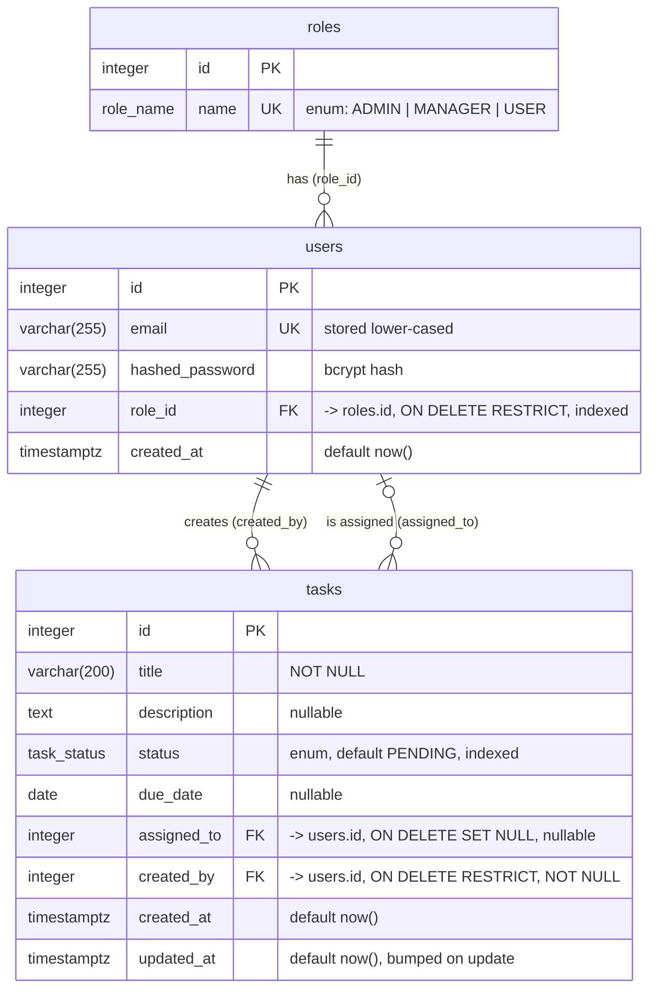

# Entity-Relationship Diagram

Source of truth: `app/models/` and the Alembic migrations in `alembic/versions/` (`0001` schema, `0002` role seed).

## Relationships

| Relationship | Cardinality | FK | On delete |
|---|---|---|---|
| role → users | 1 to N (each user has exactly one role) | `users.role_id` → `roles.id`, NOT NULL | `RESTRICT` |
| user → tasks created | 1 to N (each task has exactly one creator) | `tasks.created_by` → `users.id`, NOT NULL | `RESTRICT` |
| user → tasks assigned | 0..1 to N (a task has at most one assignee) | `tasks.assigned_to` → `users.id`, nullable | `SET NULL` |

## Enums

PostgreSQL native enum types. They mirror the Python `StrEnum`s in `app/models/enums.py`.

| Type | Values | Used by |
|---|---|---|
| `role_name` | `ADMIN`, `MANAGER`, `USER` | `roles.name` |
| `task_status` | `PENDING`, `IN_PROGRESS`, `COMPLETED` | `tasks.status` |

The database rejects invalid values even if application validation is bypassed. Allowed transitions between statuses are business rules, enforced in `app/services/task_service.py` (see the README).

## Constraints and indexes

| Name | Columns | Purpose |
|---|---|---|
| `pk_roles`, `pk_users`, `pk_tasks` | `id` | Primary keys |
| `uq_roles_name` | `roles.name` | One row per role |
| `uq_users_email` | `users.email` | Unique emails. Emails are lower-cased before storage, so uniqueness is case-insensitive. |
| `ix_users_role_id` | `users.role_id` | FK lookups, and lets PostgreSQL check `RESTRICT` without a sequential scan |
| `ix_tasks_status` | `tasks.status` | `GET /tasks?status=...` filter |
| `ix_tasks_assigned_to_created_at` | `(assigned_to, created_at)` | USER visibility (`assigned_to = :me`) sorted by recency. Also covers FK lookups on `assigned_to`. |
| `ix_tasks_created_by_created_at` | `(created_by, created_at)` | MANAGER visibility (`created_by = :me OR assigned_to = :me`, which can use both composite indexes through a bitmap OR). Also covers FK lookups on `created_by`. |
| `ix_tasks_created_at_id` | `(created_at, id)` | ADMIN listing (no visibility filter), ordered by `created_at DESC, id DESC`. |

Constraint and index names come from the naming convention on `Base.metadata` (`app/db/base.py`), so autogenerated migrations are deterministic.

## Why these delete rules

- **`users.role_id` RESTRICT.** Roles are reference data seeded by migration `0002`. Deleting a role that users still hold would leave them without permissions, so the database refuses.
- **`tasks.created_by` RESTRICT.** A task's creator is part of its audit trail and drives MANAGER visibility. A user who created tasks can't be deleted until those tasks are deleted or reassigned to another creator.
- **`tasks.assigned_to` SET NULL.** Assignment is transient. If the assignee is deleted, the task stays and becomes unassigned, ready to be reassigned.

## Design notes

- **Roles in a table rather than a column enum on `users`.** This follows the brief (`roles` entity, `users.role_id`), and new roles or role metadata can be added without changing the `users` table. The role name itself is still an enum, so typos are impossible.
- **`due_date` is a `DATE`.** Due dates are calendar days, so storing a time and timezone would add ambiguity without adding information. The API rejects past dates at creation.
- **Timestamps are `timestamptz`**, set by the database (`now()`). `updated_at` is refreshed by the ORM on every update.
- **`title` is limited to 200 characters**, matching the request schema. `description` is `TEXT`, and the schema caps it at 5000 characters.
